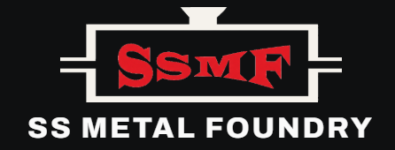

# SSMF - SS Metal Foundry 🏭

## Sistema de Control de Piso, Operaciones y Monitoreo de Hornos (MES / SCADA)



Sistema integral de gestión de producción, control de coladas y telemetría de hornos de fundición de acero, diseñado para optimizar el consumo energético, evitar la porosidad por incompatibilidad química y garantizar la trazabilidad completa de órdenes de trabajo (OTs).

---

## 🚀 Características Principales

### 1. 📋 Alta de Orden de Trabajo (OT)

* **Folios autogenerados:** Asignación secuencial automática (`OT-2026-092`, `OT-2026-093`, etc.) consultada directamente desde la base de datos.
* **Selector de materiales con etiquetas dinámicas:** Permite seleccionar y remover aleaciones (*Acero al Carbón, Chatarra de Retorno, Ferroaleaciones, Aleación Especial, Hierro Nodular, etc.*).
* **Calendario de entrega interactivo:** Navegación mes a mes y año a año con selección visual de días y estilo térmico idéntico al panel industrial.
* **Matriz de hornos en tiempo real:** Visualización de capacidades (*Horno A: 1.5 Ton, Horno B: 1.8 Ton, Horno C: 2.0 Ton*), switches de control e indicadores de ocupación (*Ocupado / Disponible / Mantenimiento*).

### 2. 🔥 Proceso de Fundición (Monitoreo en Vivo)

* **Barras de progreso en tiempo real:** Seguimiento porcentual de avance por colada con fases operativas (*Carga, Fusión, Afino, Vaciado a Crisol*) y tiempo restante estimado.
* **Telemetría de hornos:** Curvas SVG dinámicas de calentamiento con picos térmicos hasta **1550°C** y monitoreo de tonelaje.
* **Simulación interactiva:** Botón para avanzar el ciclo de colada en piso (+10%). Al alcanzar el 100%, la orden se traslada automáticamente a terminadas.
* **Asistente Metalúrgico de Recomendaciones:**
  * **Eficiencia térmica:** Sugiere automáticamente coladas para aprovechar el calor residual de hornos libres (ahorro del 30% de energía).
  * **Prevención de porosidad:** Alertas rojas de advertencia que impiden programar aleaciones incompatibles tras acero sin previa limpieza.

### 3. 📊 OTs Terminadas, Calidad & Analítica

* **Historial de coladas exitosas:** Registro de OTs con insignia `✓ LOGRADA EN TIEMPO Y FORMA` y comparativa de tiempo estimado vs. tiempo real.
* **Métricas OEE:** Gráfica de dona con efectividad del **94%** de cumplimiento a tiempo y resumen de cero moldes porosos reportados.
* **Descarga de Reportes:**
  * **Descargar PDF:** Genera un documento con membrete oficial de SSMF, resultados de espectrometría química *(C, Si, Mn, P, S)*, normas ISO 9001/ASTM A216 y líneas de firma para Inspector y Jefe de Planta.
  * **Descargar CSV:** Exportación inmediata compatible con Excel con la totalidad de registros y dictámenes metalúrgicos.

---

## 🛠️ Stack Tecnológico

* **Frontend:**
  * [React 18](https://react.dev/) + [Vite](https://vitejs.dev/)
  * [Tailwind CSS](https://tailwindcss.com/) (Tema oscuro industrial SCADA / Dark Foundry)
  * [Lucide Icons](https://lucide.dev/) (Iconografía industrial)
* **Backend:**
  * [Node.js](https://nodejs.org/) + [Express](https://expressjs.com/)
  * [MySQL 2](https://github.com/sidorares/node-mysql2) (Pool de conexiones asíncronas)
* **Base de Datos:**
  * [MySQL / MariaDB](https://www.mysql.com/) compatible con **phpMyAdmin** (`ssmf_db`)

---

## 📁 Estructura del Proyecto

```text
SSMETAL/
├── Imagenes/               # Logotipo original y recursos gráficos
│   └── Logo.png
├── public/                 # Assets estáticos y favicon
│   ├── Imagenes/Logo.png
│   └── Logo.png
├── server/                 # Backend API y capa de persistencia
│   ├── db.js               # Conexión MySQL, auto-creación de tablas y seeding
│   └── index.js            # Endpoints REST (/api/ots, /api/furnaces, etc.)
├── src/
│   ├── components/         # Módulos y vistas principales
│   │   ├── Header.jsx              # Barra superior, navegación y reloj
│   │   ├── TabAltaOT.jsx           # Formulario de alta y calendario
│   │   ├── TabProcesoFundicion.jsx # Tablero SCADA y curvas térmicas
│   │   ├── TabOTsTerminadas.jsx    # Histórico, continuidad y métricas
│   │   └── ModalReportes.jsx       # Modal y exportación a PDF y CSV
│   ├── data/
│   │   └── mockData.js     # Datos iniciales y catálogo de materiales
│   ├── App.jsx             # Estado global, sincronización con API y footer
│   ├── index.css           # Directivas Tailwind y estilos de colada
│   └── main.jsx            # Punto de entrada de React
├── .gitignore              # Exclusiones de Git (node_modules, dist, etc.)
├── package.json            # Dependencias y scripts de ejecución
├── tailwind.config.js      # Configuración de colores y fuentes
└── vite.config.js          # Configuración de Vite y proxy inverso (/api -> 3001)
```

---

## ⚡ Instalación y Puesta en Marcha

### Prerrequisitos

1. **Node.js** (v18 o superior).
2. **Servidor MySQL activo** (por ejemplo, XAMPP, WampServer o servicio MySQL en el puerto estándar `3306` con usuario `root` y sin contraseña por defecto).

### 1. Clonar o ingresar al directorio

```bash
cd SSMETAL
```

### 2. Instalar dependencias

```bash
npm install
```

### 3. Iniciar el sistema (Frontend + Base de Datos simultáneamente)

```bash
npm run dev
```

El comando iniciará automáticamente:

* 🌐 **Frontend (Vite):** [http://localhost:3000](http://localhost:3000)
* ⚙️ **API Backend (Express):** [http://localhost:3001](http://localhost:3001)
* 🗄️ **Base de Datos:** Se conectará automáticamente a MySQL y creará la base de datos **`ssmf_db`** (visible en phpMyAdmin).

---

## 📡 Endpoints de la API REST

| Método | Endpoint | Descripción |
| :--- | :--- | :--- |
| `GET` | `/api/ots` | Obtiene todas las OTs (activas y terminadas) |
| `POST` | `/api/ots` | Registra una nueva Orden de Trabajo en MySQL |
| `PUT` | `/api/ots/:id/progress` | Actualiza porcentaje de avance, fase y tiempo restante |
| `PUT` | `/api/ots/:id/complete` | Finaliza una colada y libera el horno asignado |
| `GET` | `/api/next-folio` | Calcula el siguiente número correlativo disponible |
| `GET` | `/api/furnaces` | Consulta el estado y telemetría de los hornos |
| `PUT` | `/api/furnaces/:id` | Modifica estado (*LIBRE / EN PROCESO / MANTENIMIENTO*) |

---

## 📜 Compilación para Producción

Para compilar la aplicación para despliegue en servidor estático o producción:

```bash
npm run build
```

Los archivos optimizados se generarán en la carpeta `dist/`.

---

## 🏢 Créditos

Desarrollado para **SSMF - SS Metal Foundry S.A. de C.V.**  
*Planta Fundición de Aceros Especiales • 2026*
