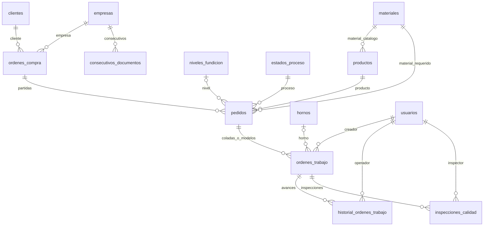

# Tablas y relaciones

| Tabla | Datos y reglas |
|---|---|
| `empresas` | SSMF: SS Metal Foundry. SFS: Steel Fused Solutions. Código único. |
| `usuarios` | Nombre, correo único, contraseña cifrada con hash, rol, estado activo y adscripción opcional. |
| `clientes` | Cliente, RFC y correo opcionales. |
| `materiales` | Nombre único y descripción. |
| `niveles_fundicion` | Cinco filas numeradas 1–5; nombres editables. Nivel opcional hasta que el responsable lo asigne. |
| `estados_proceso` | Pendiente, modelo faltante, modelado/moldeo, programado, fundición, tratamiento térmico, maquinado, acabados, calidad y terminado. |
| `productos` | Código interno, nombre, material por FK, peso sugerido y booleano de maquinado. Variantes por código + nombre + material. |
| `ordenes_compra` | FK de empresa y cliente, números de compra interno y externo, fechas de compra y compromiso. Número interno único dentro de la empresa. Una compra exterior puede tener varias compras internas. |
| `pedidos` | Partida del backlog: código, compra, producto, material requerido, nivel, proceso, tipo fundición/modelo, cantidad, peso por pieza, pendientes, maquinado, disponibilidad del modelo y programación manual. |
| `hornos` | Horno, capacidad kg, disponible/en proceso/mantenimiento y última temperatura manual. La OT activa se consulta por relación. |
| `consecutivos_documentos` | Empresa + serie + año únicos; último consecutivo. El bloqueo de empresa protege el primer uso y la numeración concurrente. |
| `ordenes_trabajo` | Pedido, creador, horno opcional, tipo interna/externa, código único, peso, piezas para modelos, porcentaje, fase, estimación, inicio, fin y cumplimiento. |
| `historial_ordenes_trabajo` | Bitácora de porcentaje, fase, fecha, responsable y notas por avance. |
| `inspecciones_calidad` | OT, inspector, composición química opcional, porosidad, dictamen y observaciones. Permite varias inspecciones por OT. |
| `bitacora_sistema` | Acción administrativa u operativa, entidad, ID, usuario y detalles sin contraseñas. |
| `sesiones`, `tokens_recuperacion_contrasena` | Infraestructura de autenticación Laravel. No hay envío de recuperación configurado. |
| `migraciones`, `datos_cache`, `bloqueos_cache`, `trabajos_cola`, `lotes_trabajos`, `trabajos_fallidos` | Infraestructura Laravel; el entorno local usa caché de archivos y cola síncrona. |

## Identificadores

- Claves primarias numéricas para relaciones; el folio visible es una columna única independiente.
- `SSMF-PF-2026-00001`: pedido de fundición.
- `SFS-PM-2026-00001`: pedido de modelo.
- `SSMF-OTI-2026-00001`: OT interna.
- `SFS-OTE-2026-00001`: OT externa.
- Los números de compra se capturan como referencias del cliente y de la empresa, sin generar ni confundirlos con folios de OT.

## Integridad y cantidades

Las FKs de negocio restringen eliminaciones para conservar trazabilidad. No hay eliminación de catálogos desde la interfaz. Crear y terminar OTs utiliza transacciones y bloqueos. La finalización de una colada no declara automáticamente que el producto está listo para entrega: pasa a maquinado o acabados según el pedido. Un modelo terminado descuenta piezas y queda terminado cuando no tiene pendientes.

Fundición controla pendientes por kg. El pendiente estimado en piezas se deriva del peso unitario; no sustituye una inspección o conteo físico. Modelos controla pendientes por piezas; puede tener peso cero. La programación utiliza año y semana ISO opcionales juntos, con fechas de lunes a domingo derivadas únicamente cuando se asigna manualmente.

Las compras se consideran cabeceras: sus fechas se comparten entre sus partidas. Si una compra requiere compromisos distintos por partida, se debe extender el modelo con fechas en `pedidos` mediante una migración incremental.

## Idioma y compatibilidad con Laravel

Las 23 tablas f?sicas, sus columnas, ?ndices y llaves for?neas tienen nombres en espa?ol, sin tildes en los identificadores SQL. Se conservan `id`, `uuid`, `token` y unidades como `kg`, por ser identificadores t?cnicos. Los c?digos de documento y los nombres de las empresas se conservan.

Ejemplos de campos: `clientes.nombre`, `usuarios.correo`, `usuarios.contrasena`, `pedidos.cantidad`, `pedidos.modelo_recibido`, `pedidos.peso_unitario_kg`, `pedidos.peso_por_fundir_kg`, `ordenes_trabajo.avance`, `sesiones.ultima_actividad` y `migraciones.nombre`.

Las fechas de los modelos Eloquent se llaman `creado_en` y `actualizado_en`. Los perfiles, tipos y estados tambi?n usan claves en espa?ol: `administrador`, `operador`, `consulta`, `fundicion`, `modelo`, `interna`, `externa`, `en_proceso` y `terminado`.

Laravel necesita ciertos nombres de columna en su interfaz interna. Para conservar esa interfaz sin alterar el c?digo del framework se usan siete vistas actualizables de MySQL:

| Tabla f?sica en espa?ol | Vista de compatibilidad |
|---|---|
| `sesiones` | `adaptador_sesiones` |
| `tokens_recuperacion_contrasena` | `adaptador_tokens_recuperacion_contrasena` |
| `datos_cache` | `adaptador_datos_cache` |
| `bloqueos_cache` | `adaptador_bloqueos_cache` |
| `trabajos_cola` | `adaptador_trabajos_cola` |
| `lotes_trabajos` | `adaptador_lotes_trabajos` |
| `trabajos_fallidos` | `adaptador_trabajos_fallidos` |

Estas vistas no duplican informaci?n. Exponen alias t?cnicos al framework y escriben sobre las tablas con columnas en espa?ol. No deben eliminarse. `migraciones` usa el repositorio adaptado `app/Database/RepositorioMigraciones.php` y no requiere una vista.

El despliegue de la aplicaci?n utiliza MySQL/MariaDB. SQLite en memoria se utiliza para probar los flujos de negocio; los servicios internos con vistas actualizables se verifican sobre MySQL.

La traducci?n se aplica con una migraci?n incremental. Las migraciones hist?ricas conservan sus nombres y reproducen el esquema anterior antes de aplicar la traducci?n en una instalaci?n nueva; no deben editarse ni ejecutarse manualmente fuera de Artisan.
